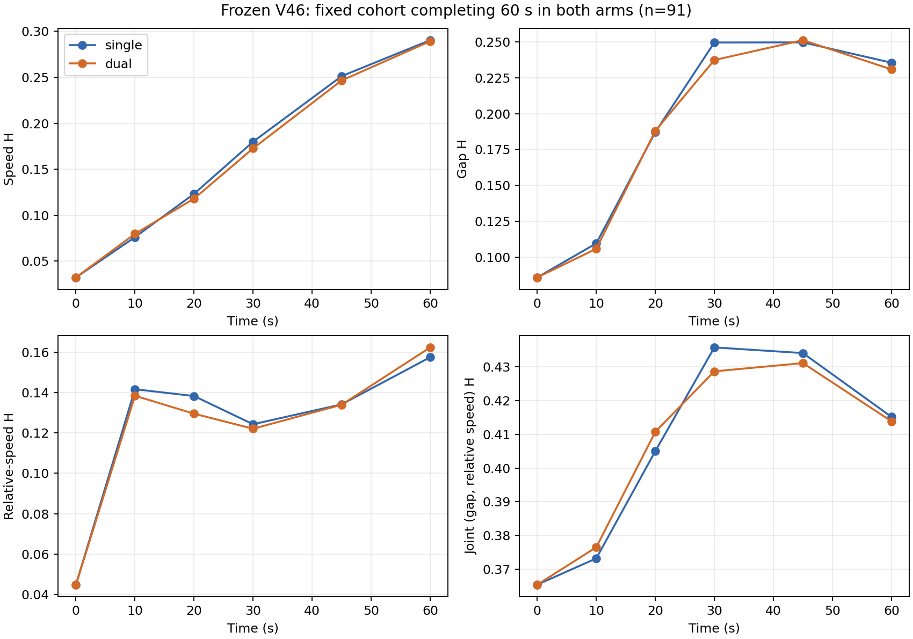

# V46 matched NDE fidelity comparison：100 组配对实验

日期：2026-10-04。结论：**双车联合对加速度交互结构有明确改善；整体状态分布只有小幅改善，长时漂移仍在，尚不足以宣布双车 NDE 全面优于单车。** 本轮没有优化或改动冻结模型。

这里的 Single-NDE 是 highD 上、保留相同 V34 单车概率与显式换道可行性限制的独立采样适配，不是原论文完整算法的数值复现。没有将本结果与论文的 0.053/0.102 比较，也没有推断 D2RL 加速收益。

## 实验合同与原始证据

协议在运行前提交于 `203ab2d`，见 [配置](../configs/highd_v46_matched_fidelity_v1.json)。冻结自然模型仍是 `nde-v46-frozen-20261003`，身份 `106a9fbc795c75c9d4f60a880da7264cb626f9163e5ec073b720e6b48c6f9db5`。

使用新 seed **40000–40099**，每个 seed 生成一次完整车流，两组恢复完全相同的车辆状态与初始化后的 RNG 状态。100 组的初始数组、共同决策期间逐车随机数均逐值相同。独立组只将 joint dependence 切换为 independence；两组均采用同一套配对基础设施，其余 highD 表、初始化、1 s maneuver、换道 1 s/a=0、15 Hz 动力学、速度边界、车道模型和 60 s 时域相同。

模型没有固定 IDM CAV，全部车辆均来自自然过程，因此 CAV 碰撞数为“不适用”；没有偷偷插入新的控制器。相关性关闭后的 10 s 实际轨迹和动作，与未经修改的原单车 executor 逐值一致。最大单车边缘误差为 3.89e-16。

观测器只在原 executor 完成每个物理子步后读取状态。10 Hz 评分通过精确纵向插值和线性横向插值获得，不重新模拟，不改变碰撞检测。真实 highD 参考沿用相同十个 train 录像，1,672,818 个速度样本、1,111,156 个跟驰样本，三个原始边缘直方图与冻结参考逐格完全一致。联合状态使用同一批跟驰暴露。所有分箱在协议中固定，包含两侧尾箱，不加伪计数；MAE 指归一化概率质量逐箱 MAE，不是轨迹坐标误差。

完整 200 次运行只进行一次，未因失败替换 seed。**主表对每个 seed 只使用两组共同的碰撞前观察时长**，共 5,740.8 s/组；相同时间不强制产生相同跟驰样本数。全部可用暴露和两组均完成的 91 个 seed 作为另外两种口径保留。任何“共同完成/共同持续车对”子集都带有结果条件筛选，不能代替全体结果。

Bootstrap 为 2,000 次、seed=20261004，以整个 episode seed 为配对重采样单元。置信区间只反映固定 highD 参考下的 Monte Carlo 波动，不包括真实数据参考分布的不确定性。这批 highD 数据以前参与过拟合/开发，不能称为新的独立 test。

## 第一层：NDE fidelity

以下为主表 pooled histogram 指标，均越小越好。相对变化为 `(Dual/Single-1)*100%`。

| 指标 | Single | Dual | 相对变化 |
|---|---:|---:|---:|
| Speed H | 0.150689 | 0.147163 | -2.34% |
| Speed probability MAE | 0.014055 | 0.013763 | -2.08% |
| Gap H | 0.186704 | 0.182904 | -2.04% |
| Gap probability MAE | 0.002725 | 0.002679 | -1.70% |
| Relative-speed H | 0.103196 | 0.101698 | -1.45% |
| Joint (gap, relative speed) H | 0.231003 | 0.224271 | -2.91% |

不能只看这六个百分比。Pooled 距离之差和逐 seed 距离之差的平均是两个不同的估计量：

| 指标 | Pooled Δ 的 95% CI | Mean seed Δ | Mean seed Δ 的 95% CI |
|---|---:|---:|---:|
| Speed H | [-0.006844, +0.000077] | -0.000978 | [-0.004871, +0.003009] |
| Gap H | [-0.008761, +0.001487] | -0.002393 | [-0.006880, +0.002084] |
| Relative-speed H | [-0.005454, +0.002355] | **+0.001870** | [-0.001542, +0.005370] |
| Joint state H | **[-0.011615, -0.001224]** | -0.001041 | [-0.004806, +0.002628] |

Δ 均为 Dual−Single。联合状态的 pooled 改善有配对 bootstrap 支持，但逐 episode 平均改善尚未明确。相对速度 pooled 略好，逐 episode 平均差反而略正，两种 CI 都不能确认改善。速度/净距未发现显著恶化，也不能把“不显著”当成已经完成非劣性证明；本轮没有事后指定非劣性阈值。

口径敏感性如下，不删除失败运行：

| 暴露口径 | H(speed) S/D | H(gap) S/D | H(rr) S/D | H(g,rr) S/D |
|---|---:|---:|---:|---:|
| 全部 100 seed 的共同观察时长 | .150689/.147163 | .186704/.182904 | .103196/.101698 | .231003/.224271 |
| 各组全部可用时长 | .152544/.149041 | .188771/.185529 | .102557/.101847 | .232423/.226323 |
| 共同完成 60 s 的 91 seed | .158550/.155307 | .188198/.184177 | .102816/.101547 | .231713/.225011 |

## Rollout drift

为了不把逐时刻样本群变化误认为 drift，下表和主图使用两组都完成 60 s 的**固定 91 seed**。它仍是条件于完成的结果。另一个逐时刻共同可观察表在 CSV/JSON 中；其 n 依次为 100、99、99、97、92、91。

| t/s | H(speed) S/D | H(gap) S/D | H(rr) S/D | H(g,rr) S/D |
|---|---:|---:|---:|---:|
| 0 | .032331/.032331 | .085733/.085733 | .044737/.044737 | .365347/.365347 |
| 10 | .076128/.079725 | .109497/.105739 | .141739/.138513 | .373155/.376466 |
| 20 | .123224/.117980 | .187160/.188023 | .138358/.129588 | .405010/.410747 |
| 30 | .179895/.172636 | .249696/.237458 | .124363/.122134 | .435823/.428720 |
| 45 | .251189/.246525 | .249765/.251323 | .134221/.134036 | .434140/.431166 |
| 60 | .290353/.289139 | .235583/.230909 | .157618/.162490 | .415183/.413876 |

双车没有解决速度分布随时间漂移的问题，也不是所有时间点都更好：60 s 的相对速度 H 反而略高。单时刻联合直方图比 pooled 直方图稀疏，绝对距离不应直接跨两种样本量解释。



## 第二层：interaction fidelity

使用前后车同步的有效 1 s 加速度，量化到固定 0.2 m/s² 网格。真实参考使用冻结 V46 的稳定/安静区间选择器：两车有 3 s 过去关系/车道历史、完整未来 1 s 端点，并在该区间保持相应稳定性。未来仅用于离线标签。真实动作即使在拟合模型中概率为零也保留，不按模型支持过滤出“好算”的样本。

实测动作对 33,581 个；主表仿真分别为 140,782 / 141,044 个合格跟驰区间。统计所有合格邻接关系，而不仅是恰好被 matching 选中的车对，避免只报告联合模型真正作用的子集。

| 指标 | Single | Dual | 相对变化 | Mean seed Δ 的 95% CI |
|---|---:|---:|---:|---:|
| H(front acceleration, rear acceleration) | .248688 | .214269 | **-13.84%** | [-.031226, -.027041] |
| H(front−rear acceleration) | .223440 | .185641 | **-16.92%** | [-.039243, -.034420] |
| 相对 highD 的加速度相关系数绝对误差 | .418155 | .351203 | **-16.01%** | [-.080991, -.061222] |

加速度相关系数本身为：**highD=.483505，Single=.065350，Dual=.132302**。双车确实恢复了部分独立采样缺失的相关结构，但距离真实相关性仍很大。

这些是所声明稳定跟驰暴露中的整体动作比较，仍可能受运行状态分布变化影响，不能解读为任意状态下都校准准确。

## Persistent following pairs

真实录像中最长单车轨迹为 36.56 s，固定数据内没有可观察 60 s 的持续车对。因此 **60 s persistent fidelity 为 N/A**，没有用普通跟驰参考假装 60 s 真值。仿真 60 s 持续车对分别为 1,444 / 1,406，其中同 seed、同一车对在两组都持续的为 1,116。

另做协议预先声明的 **5 s 完整窗口**：真实数据有 11,804 个窗口，两组共同持续、相同 ID 的仿真窗口有 26,018 个。窗口内一直保持同一前后车及车道身份、有效速度/净距；真实两车 abs(yVelocity)<0.2 m/s，仿真两车均无进行中换道。每组均有 1,300,900 个评分样本。CI 仍按 episode seed 重采样，未把窗口当独立样本。

| 指标 | Single | Dual | 相对变化 | Mean seed Δ 的 95% CI |
|---|---:|---:|---:|---:|
| Persistent gap H | .190140 | .188371 | -0.93% | [-.003790, +.003695] |
| Persistent gap probability MAE | .002693 | .002668 | -0.95% | [-.000083, +.000072] |
| Persistent relative-speed H | .091740 | .083333 | **-9.16%** | [-.006220, -.001036] |
| Persistent relative-speed probability MAE | .005085 | .004683 | **-7.90%** | [-.000639, -.000253] |
| Persistent joint state H | .249474 | .242453 | -2.81% | [-.005535, +.002169] |

这一层支持短窗口稳定跟驰中相对速度保真度改善；净距改善尚不明确。初始化是经验分布生成的车流，没有与每辆仿真车一一对应的真实未来轨迹，因此不能计算有物理单位的逐轨迹 gap/relative-speed MAE。这里明确报告的是 probability MAE。

## 第三层：runtime robustness

| 指标 | Single | Dual |
|---|---:|---:|
| 60 s 完成 | 95/100 | 95/100 |
| BV 碰撞场景 | 5/100 | 5/100 |
| CAV 碰撞 | N/A | N/A |
| Minimum pre-contact TTC <1.5 s 的场景 | 26/100 | 30/100 |
| 全样本最小 pre-contact TTC/s | .018972 | .022917 |
| 每场最小 TTC 的中位数/s | 1.987303 | 1.943333 |
| 初始几何 overlap 对数 | 0 | 0 |
| 运行中矩形接触场景 | 5 | 5 |
| 首次接触最大纵向穿透/m | .112 | .200 |
| 换道启动数 | 688 | 731 |
| 实际相关配对决策数 | 0 | 64,396 |
| 同时配对最大组数 | 19 | 19 |
| 内部 rollout 耗时总和/s | 110.451 | 111.762 |

两组碰撞的 seed 并非相同：仅单车碰撞为 40017/40034/40048/40053，仅双车碰撞为 40000/40040/40051/40063，另有一个共同碰撞 seed。配对碰撞概率差估计 0，95% CI=[-6.00,+5.025] 个百分点；near-collision 差 +4 个百分点，CI=[-5.025,+13.00]。样本不足以证明安全等价。

TTC 按每个 15 Hz 物理状态的横向车体重叠候选中最近前车计算，只使用接触前的正间距/正接近速度。终止时正矩形 overlap 是碰撞检测的接触证据，不能仅凭正 overlap 判断为额外的“非物理”错误。运行轨迹和安全统计保留终止接触帧，分布统计使用上述预先定义的接触前暴露；没有插入安全控制。

总内部耗时约增加 1.19%；每仿真车辆秒的中位耗时从 .5370 ms 到 .5391 ms，约增加 .38%。两组均运行 joint-matching 基础设施；4 个进程、次序按 seed 奇偶交替，计时含观测开销，不包括加载/压缩/评分。这是本次工程耗时记录，不是正式硬件性能基准。

## 判定与下一步边界

目前有证据支持的表述是：**冻结 V46 的双车耦合改善了所评估跟驰动作的联合分布及短窗口相对运动；整个车流的状态保真优势较小且不一致，长期漂移仍需解决。**

用户提出的完整判定条件尚未全部满足：全流量 relative-speed H 改善没有明确配对证据，联合状态只有 pooled 层面更明确，persistent gap 也没有明确改善。没有因结果接近预期而追加 seed、调整分箱或调模型。本实验可以支撑交互结构的消融结果，不能直接作为 multi-BV D2RL 效率证明。

## 文件与复现

- [完整摘要与所有 CI](../results/highd_v46_matched100_summary.json)
- [主指标与交互指标 CSV](../results/highd_v46_matched100_metrics.csv)
- [逐 seed 指标与碰撞 CSV](../results/highd_v46_matched100_episode_metrics.csv)
- [逐时刻共同可观察样本 CSV](../results/highd_v46_matched100_time_common.csv)
- [固定 91 seed 的时间曲线 CSV](../results/highd_v46_matched100_time_fixed91.csv)
- [漂移图 PDF](figures/highd_v46_matched100_drift.pdf)、[pooled 图 PDF](figures/highd_v46_matched100_pooled.pdf)

完整轨迹、初始车流、逐车随机数和中间产物在 ignored 的 `data_analysis/raw_data/highd_v46_matched100_v1`；最终使用 `highd_v46_matched_reference_v2` 和 `outputs/highd_v46_matched_report_v2`。早期 reference/report v1 保留，但其 persistent source 窗口没有施加 quiet 条件，已由 v2 修正以匹配仿真无活动换道条件；不改变任何 rollout 或其他指标。

Python 3.12.7；安装 `configs/requirements-highd-v46-matched.txt`，拉取 V46 LFS 资产。需要持有原始 highD 数据，不能只从拟合边缘表恢复真实联合状态和动作统计。以下输出目录必须尚不存在：

```bash
python -m scenario_reconstruction.highd_v46_matched_reference --source-root PATH_TO_LICENSED_HIGHD --output outputs/matched_reference
python -m scenario_reconstruction.highd_v46_matched_runtime --output outputs/matched_rollouts --workers 4
python -m scenario_reconstruction.highd_v46_matched_report --rollout outputs/matched_rollouts --reference outputs/matched_reference --output outputs/matched_report
```

四项有针对性的评分检查通过：速度边界处精确插值、旧邻接观测一致性、持续窗口的完整端点要求、相同两组的配对 bootstrap 零差。
