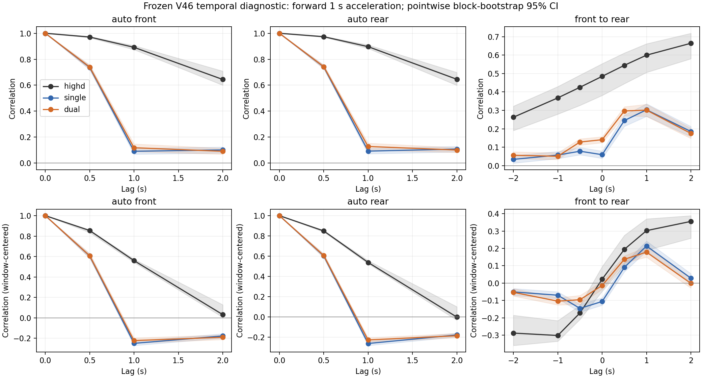

# V46：非劣性／等效性检验与跨时间相关性诊断

日期：2026-10-05。**全程共同暴露下，逐 episode 的速度 H、净距 H 平均差均通过 0.01 界值的非劣性检验，也通过 ±0.01 等效性检验。60 s 终点的速度 H 尚不能确认非劣。Dual 的同时刻相关性改善明确，但没有延续成 1–2 s 前后车滞后相关性的明确优势。**

这是对 [100 组 matched comparison](highd_v46_matched_fidelity_100.md) 的统计补充。冻结 V46、单车／双车采样器、动力学、换道模型均未修改，没有新增 rollout，没有训练 D2RL，也没有创建 V47。

## 分析范围与证据来源

- 原比较提交：`c5c5d06eee2b416d5aa403077edc92bd2b7fdfdb`；tag：`nde-v46-matched100-20261004`。
- 本轮分析协议在提取新诊断前提交于 `a938007`，见 [配置](../configs/highd_v46_ni_temporal_v1.json)。0.01 界值是用户看过原结果后指定的；**属于事后界值分析，不能称为事前注册的确认性检验**。尚无外部依据证明 0.01 就是领域认可的实际重要性界值。
- 自然模型仍为 `nde-v46-frozen-20261003`，身份 `106a9fbc795c75c9d4f60a880da7264cb626f9163e5ec073b720e6b48c6f9db5`。运行时源码和资产通过原冻结校验；200 份轨迹及十个 highD 录像的 tracks/tracksMeta/recordingMeta 均按已有 SHA-256 核验。
- 使用原 100 对 seed 40000–40099，保留原失败场景。宏观主估计对象是**逐 episode H 距离之差的平均**，每对只使用两组共同碰撞前时长，共 5,740.8 s/组；它不等于 pooled histogram H 的差。
- highD 参考仍是原十个 train 录像，并非全新独立 test。宏观检验条件于固定真实参考；时间诊断另对真实录像进行整块重采样。

## 配对非劣性与等效性

令每个 seed 的差为 $d_i=H_i^{Dual}-H_i^{Single}$，负数表示 Dual 更接近固定 highD 参考。非劣性检验为 $H_0:E[d]\geq0.01$，$H_1:E[d]<0.01$。主方法使用配对差值的单样本 t 检验：单侧 95% 上界低于 0.01 即通过。速度和净距作为两个共同主指标，**两者都通过**才作联合非劣性结论。

等效性采用 TOST，两个单侧检验各 α=0.05，等价于双侧 90% CI 完全位于 (-0.01,+0.01)。这与“差异检验不显著”不同；方法依据可参见 [NIST TN 2106，第 5 节](https://nvlpubs.nist.gov/nistpubs/TechnicalNotes/NIST.TN.2106.pdf)。

| 指标，n=100 | Mean Dual−Single | 单侧 95% 上界 | 非劣性 p | 90% CI | TOST p | 0.01 非劣／等效 |
|---|---:|---:|---:|---|---:|---|
| Speed H | -0.000978 | **0.002335** | 1.47e-7 | [-0.004291, 0.002335] | 8.52e-6 | 通过／通过 |
| Gap H | -0.002393 | **0.001538** | 4.64e-7 | [-0.006323, 0.001538] | 8.85e-4 | 通过／通过 |

5,000 次整 seed 配对 percentile bootstrap 的单侧 95% 上界分别为 **0.002286、0.001533**，与 t 方法一致。另报告更保守的两个指标 Bonferroni 同时单侧 95% 上界：**0.002981、0.002305**，也都小于 0.01。联合“两个都非劣”的 intersection-union 判定本身不需要这一额外修正。

界值敏感性完整保留，不按结果重新挑界值：

| 允许退化界值 | Speed 非劣 | Gap 非劣 | 两个都等效于相应 ±界值 |
|---|---|---|---|
| 0.002 | 未建立 | 通过 | 否 |
| 0.005 | 通过 | 通过 | 否；Gap 的负端超出 -0.005 |
| 0.010 | 通过 | 通过 | 是 |

“等效”不是两模型相同，也不是宏观指标显著改善；这里仅指相应平均距离差被控制在指定范围内。

### 不能将全程平均结论推广到每个时刻

另对两组都完成 60 s 的固定 91 个 seed 计算终点指标。这是条件于两组完成的次级分析，不能覆盖失败场景。

| 60 s 指标，n=91 | Mean Dual−Single | 单侧 95% 上界 | 非劣性 p | 0.01 非劣 | ±0.01 等效 |
|---|---:|---:|---:|---|---|
| Speed H | +0.005948 | **0.013576** | 0.1899 | **未建立** | 未建立 |
| Gap H | -0.007399 | -0.001819 | 6.67e-7 | 通过 | 未建立 |

Speed 的区间仍容许超过 0.01 的退化；这不等于证明发生了退化。Gap 的 90% CI 是 [-0.012978,-0.001819]，不满足对称等效是因为负端容许较大改善，并不是出现了较大退化。

## 时间诊断的固定口径

使用不重叠、全局 6 s 网格上的完整稳定跟驰窗口；前后车 ID、车道、前车自己的 preceding ID 全程固定，均在 20–40 m/s，净距 (0,115]、相对速度绝对值 ≤20 m/s。真实两车横向速度绝对值 <0.2 m/s；仿真两车全程没有进行中换道。窗口包含完整右端点。

每个窗口取 t=3 s 为锚点，诊断 lag=-2,-1,-0.5,0,0.5,1,2 s。主加速度为**未量化的向前 1 s 速度增量**，因此时点相同的测量口径可比：highD 的半帧端点线性插值；仿真使用原 15 Hz 动力学的精确纵向观测插值。所有 11 个半秒网格上的有效加速度均须在 [-4,2]，不裁剪超界值。

真实 highD 共 **3,441** 个窗口（另 1 个因动作范围排除）；仿真 **20,316** 个共同窗口，两组使用完全相同的 seed、前后车 ID 和起始时刻，均在较早的终止时刻前，动作范围额外排除为 0。统计所有合格邻接车对，不只看实际选中联合采样的车对。这个全程稳定子集不同于上一轮动作比较的选择器，相关系数数值不必与旧表完全相同。

以 highD 整个录像（10 块）及仿真整个 episode seed（100 块，Single/Dual 配对）做 2,000 次 bootstrap；真实和仿真重采样随机流分开。下述 CI 为**逐点探索性 CI**，不是整条曲线同时置信带。没有把数万个相关窗口当独立样本。真实参考和仿真的状态分布未进一步重加权到完全相同的条件状态。

### 前车到后车的滞后相关性

定义 $C_{fr}(\tau)=Corr(a_f(t),a_r(t+\tau))$，正 lag 表示后车稍后。下面为主口径，括号内是按整录像／整 seed 重采样的 95% CI：

| τ/s | highD | Single | Dual | Dual−Single 的 95% CI |
|---|---|---|---|---|
| -2 | .2630 [.1909,.3232] | .0344 [.0141,.0553] | .0566 [.0379,.0753] | [.0014,.0432] |
| -1 | .3678 [.2798,.4294] | .0578 [.0389,.0772] | .0513 [.0337,.0700] | [-.0238,.0109] |
| 0 | **.4847** [.3813,.5534] | **.0598** [.0402,.0792] | **.1410** [.1249,.1574] | **[.0632,.0982]** |
| 0.5 | .5444 [.4449,.6115] | .2448 [.2139,.2740] | .2969 [.2707,.3200] | [.0246,.0792] |
| 1 | **.5996** [.5062,.6614] | **.3033** [.2680,.3362] | **.3016** [.2674,.3331] | **[-.0363,.0322]** |
| 2 | **.6640** [.5802,.7182] | **.1857** [.1575,.2131] | **.1752** [.1479,.2027] | **[-.0367,.0161]** |

真实数据的正 lag 相关明显高于相应负 lag，具有与“前车变化后、后车延续响应”一致的方向性。**但测量到 2 s 为止曲线仍在上升，不能据此定位峰值，更不能声称识别了 2 s 的因果反应时间。** 两个模型在 1 s 都有滞后相关，不能写成 Single/Dual 完全没有响应或完全没有时间依赖；状态反馈本身也会产生相关。

Dual 的额外收益主要集中于 τ=0 及 0.5 s；1 s 和 2 s 差值 CI 均跨 0。0.5 s 的向前测量窗口相互重叠，模型控制又保持 1 s，这一点不能独立支撑延迟响应改善。

### 同一车辆的加速度持续性

| Corr(a(t),a(t+τ)) | highD | Single | Dual |
|---|---:|---:|---:|
| 前车，τ=1 s | .8918 | .0913 | .1185 |
| 后车，τ=1 s | .8970 | .0924 | .1283 |
| 前车，τ=2 s | .6442 | .1015 | .0911 |
| 后车，τ=2 s | .6458 | .1081 | .1008 |

Dual 在 1 s 自相关上有小幅增益（前／后车差值逐点 CI 分别 [.0005,.0557]、[.0104,.0640]），但距离 highD 仍很大；2 s 没有明确增益。因此不能笼统说“所有跨时间指标都没有改善”，更准确的是**改善不足以恢复实测的持续性，且前后车滞后相关优势没有延续到 1–2 s**。

### 去均值与瞬时加速度敏感性

为检查总体相关是否仅来自不同车对的长期加速度均值差，另减去每辆车在各 6 s 窗口内的 11 个加速度均值：

| 去窗口均值后的指标 | highD | Single | Dual |
|---|---:|---:|---:|
| 前车自相关，1 s | .5600 | -.2489 | -.2217 |
| 后车自相关，1 s | .5383 | -.2616 | -.2265 |
| 前→后，0 s | .0228 | -.1056 | -.0132 |
| 前→后，1 s | .3023 | .2138 | .1785 |
| 前→后，2 s | .3553 | .0286 | -.0011 |

总体 τ=0 相关的一部分确实来自窗口之间的均值差；去均值后，Dual 仍修正了 Single 的同时刻偏差，但没有补足长 lag 结构。2 s 相关性相对 highD 的绝对误差差值为正，逐点 CI=[.0015,.0587]，应如实保留这个不利敏感性结果。**短窗口去均值本身会引入相关性偏差，尤其负相关；不能据此断言车辆存在真实的反向响应。**

另外保留 signed highD xAcceleration 对仿真实际执行的 held acceleration（考虑速度边界）的辅助结果。其 1 s 自相关同样明显偏低，主结论不只由速度差测量的重叠造成；但仿真瞬时自相关在 +0.5 s 接近 1，是 1 s 动作保持和固定观测相位的机械结果，不代表真实记忆已恢复。highD 轨迹及其导数的平滑处理也可能增大时间相关；本轮没有重新处理原始影像或进行平滑度匹配，无法将全部差距归因于行为模型。



## 对“交互层改善为何未充分传到状态层”的解释

令 $b_k=a_f(k)-a_r(k)$。固定步长的相对速度变化满足 $\Delta v_n-\Delta v_0=h\sum_k b_k$，因而其方差包含所有跨时间协方差：

$$Var(\Delta v_n-\Delta v_0)=h^2\sum_i\sum_j Cov(b_i,b_j).$$

改进同时刻联合动作能够改变 $Var(b_k)$，却不能保证非零 lag 的 $Cov(b_i,b_j)$ 也正确；净距还会再次累积相对速度。此次观测到的“τ=0 改善、1–2 s 前后车额外优势未延续、同车持续性仍偏弱”与这一机制一致，**是长期收益有限的可检验解释，不是已确认的唯一因果解释**。换道、配对覆盖、状态访问分布、速度边界和初始化也可能影响整体指标。

可以用于论文的限定表述：

> On the evaluated matched episodes and conditional on the fixed highD reference, Dual improved synchronous interaction fidelity while mean episode speed and gap Hellinger distances satisfied a post-hoc 0.01 non-inferiority margin. This result did not extend to speed fidelity at 60 s. Temporal diagnostics showed that the additional front–rear correlation benefit did not persist at 1–2 s lags, and both models substantially underrepresented acceleration persistence in the selected highD windows.

本轮到此冻结分析结果。未来若再研究历史条件动作或有记忆的耦合，应另开实验并使用新验证数据；这里不继续调 joint PMF，不修改 V46，也不把 NDE 统计结论替代为 D2RL 效率证据。

## 文件、复现和检查

- [非劣性完整 JSON](../results/highd_v46_noninferiority.json)：p、t CI、bootstrap CI、界值敏感性和 60 s 次级结果。
- [时间诊断完整 JSON](../results/highd_v46_temporal_summary.json)、[全部曲线 CSV](../results/highd_v46_temporal_curves.csv)、[配对差值区间 CSV](../results/highd_v46_temporal_differences.csv)。
- [矢量 PDF](figures/highd_v46_temporal_correlations.pdf)。曲线和 JSON 包含负 lag、瞬时加速度和去窗口均值结果。
- [非劣性分析代码](../scenario_reconstruction/highd_v46_noninferiority.py)、[时间诊断代码](../scenario_reconstruction/highd_v46_temporal_diagnostic.py)。

Python 3.12.7，依赖沿用 [matched comparison requirements](../configs/requirements-highd-v46-matched.txt)。需要原比较保存的轨迹和真实参考；时间诊断另外需要 licensed highD 原始 CSV。它们不上传 Git。若没有这些本地产物，可按原比较文档的固定 seed/协议生成；本次实际执行只读取现存产物。

在仓库根目录运行，目标 JSON／时间诊断目录必须尚不存在：

```bash
python -m scenario_reconstruction.highd_v46_noninferiority --rollout PATH_TO_MATCHED_ROLLOUTS --reference PATH_TO_MATCHED_REFERENCE --output outputs/ni_temporal/noninferiority.json
python -m scenario_reconstruction.highd_v46_temporal_diagnostic --source-root PATH_TO_LICENSED_HIGHD --rollout PATH_TO_MATCHED_ROLLOUTS --output outputs/ni_temporal/temporal
python -m unittest discover -s tests -p test_highd_v46_ni_temporal.py
```

NI 主分析读取仓库中已有的 `results/highd_v46_matched100_episode_metrics.csv`；终点分析核验轨迹和 reference.npz 后读取最后观测帧。配置比较会规范化 LF/CRLF，避免新 Windows worktree 的换行转换被误判为协议变化。时间诊断逐份校验真实来源、冻结资产和轨迹，未重播动力学。

四项针对性检查通过：非劣与等效的区别及恰好落在界值的退化情况；正 lag 的前→后方向；25 Hz 半帧插值；相同两组的配对 bootstrap 零差。图已检查；本轮没有运行训练或无关测试套件。
